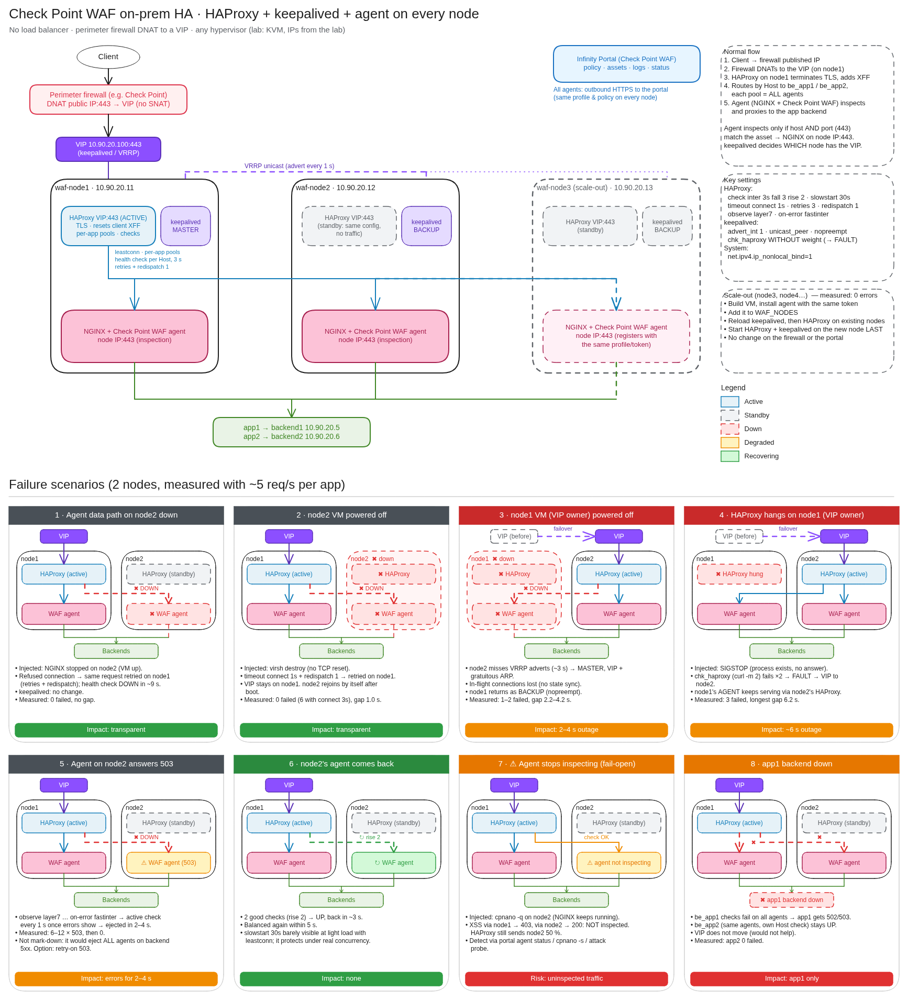
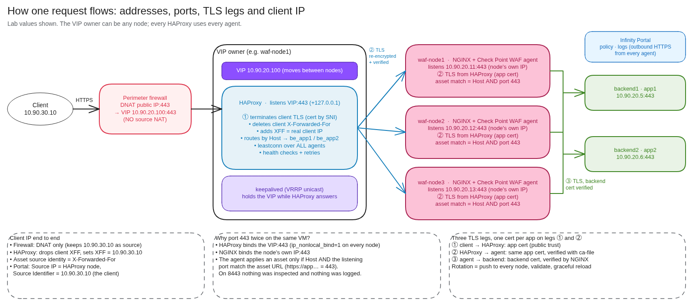
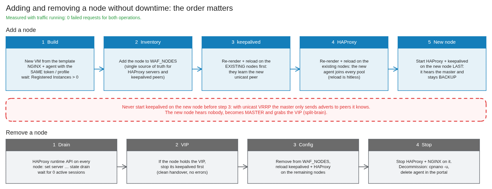
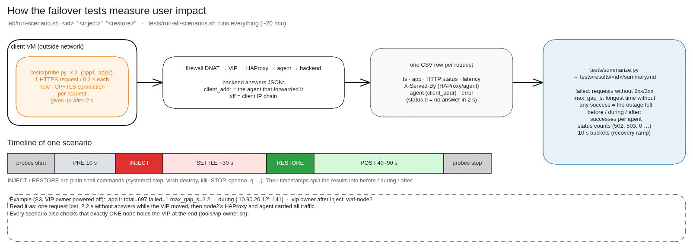

# The complete guide: Check Point WAF on-prem HA without a load balancer

> **Disclaimer:** community lab guide. This is **not** official Check Point documentation and it is **not** supported by Check Point. Validate everything in your own environment before using it in production.

This document explains the whole project in one place:

- what every component is and why it is there,
- how a request flows,
- how to build it step by step (including VMware vSphere),
- how to operate it,
- how the test battery proves that it works.

The numbered chapters in [`docs/`](docs/) contain the full detail and the raw evidence. This guide links to them where useful.

**Contents**

1. [The problem and the solution](#1-the-problem-and-the-solution)
2. [The building blocks](#2-the-building-blocks)
3. [How a request flows](#3-how-a-request-flows)
4. [Design decisions that matter](#4-design-decisions-that-matter-read-before-building)
5. [Plan before you build](#5-plan-before-you-build)
6. [Step-by-step build](#6-step-by-step-build)
7. [Day-2 operations](#7-day-2-operations)
8. [The test battery](#8-the-test-battery)
9. [The lab used to validate all this](#9-the-lab-used-to-validate-all-this)
10. [Limits and what was not validated](#10-limits-and-what-was-not-validated)

---

## 1. The problem and the solution

**The situation.** You want to protect web applications on-prem with Check Point WAF:

- you have a **perimeter firewall** (for example a Check Point cluster) in front of the apps,
- you have a **virtualization platform** (for example VMware vSphere),
- you have **no load balancer**,
- you need **more than one WAF agent**: one is a single point of failure, and you may need the capacity.

Check Point WAF agents do not form a cluster among themselves. Each one inspects the traffic it receives. Something has to spread traffic across the agents and stop sending it to a failed one. Normally that is a load balancer.

**The solution.** Build the "load balancer" into the WAF nodes themselves. Every WAF node is an identical VM running three pieces:

| Piece | Job |
|---|---|
| **keepalived** | Keeps **one floating IP (the VIP)** alive on exactly one node and moves it within seconds if that node or its HAProxy fails |
| **HAProxy** | On the node that holds the VIP: receives client traffic, spreads it across **all** nodes' agents, health-checks them and retries failed connections elsewhere |
| **NGINX + Check Point WAF agent** | The agent (Linux "NGINX add-on" deployment) inspects every request in NGINX and forwards it to the application |

The perimeter firewall just **DNATs the published IP to the VIP**. More capacity means adding another identical node, with **no change** on the firewall or in the Infinity Portal.



---

## 2. The building blocks

### Perimeter firewall

The existing firewall (for example a Check Point cluster) that publishes the applications. Its only job here is a **destination NAT**: `public IP:443 → VIP:443`, **without source NAT**, so the WAF still sees the real client IP. It does not need to know about the nodes. → [chapter 8](docs/08-firewall-dnat.md)

### VIP (virtual IP)

An extra IP address in the WAF nodes' network (lab: `10.90.20.100`). At any moment exactly **one** node holds it. When that node fails, another node takes it and announces it with a **gratuitous ARP**, and the firewall's ARP entry updates. Clients never notice which node is behind it.

### keepalived and VRRP

keepalived implements **VRRP**, the protocol that elects which node holds the VIP:

- Every node sends **adverts** (1 per second) to the other nodes, **unicast**, so the network does not need multicast. The node with the highest priority wins.
- A **track script** (`chk_haproxy.sh`) checks every 2 s that the local HAProxy **answers**. If it does not, the node enters **FAULT** and gives up the VIP.
- **`nopreempt`**: a node that comes back does not take the VIP back automatically. That avoids a second outage. Moving it back is a planned action.

→ [chapter 7](docs/07-keepalived.md)

### HAProxy

An open-source reverse proxy and load balancer. It runs on **every** node with an **identical** configuration, but only the VIP owner receives traffic. It:

- **terminates the client TLS** with each app's certificate, chosen by SNI,
- **deletes any `X-Forwarded-For` the client sent** and adds its own with the real client IP (the TCP source, which is the client because the firewall does no source NAT). This **assumes there is no proxy in front of HAProxy**; see [decision 3](#4-design-decisions-that-matter-read-before-building),
- **routes by Host** to one pool per application (`be_app1`, `be_app2`). **Each pool contains every node's agent**,
- **balances** (`leastconn`) and **health-checks** each agent end to end, per app,
- **retries** a failed connection on another agent, so the client does not see the error.

HAProxy does **not** inspect traffic. → [chapter 6](docs/06-haproxy.md)

### NGINX + Check Point WAF agent ("nano agent")

Check Point WAF on Linux is an **add-on to NGINX**:

- You install and configure NGINX yourself.
- Check Point's installer (`nanoegg`) adds a module (`ngx_cp_attachment_module.so`) that passes every request NGINX proxies to the local **agent**.
- The agent applies the policy it downloads from the Infinity Portal and returns a verdict: allow, block or log.

The agent's NGINX listens on **the node's own IP, port 443** and proxies to the application backend. → [chapter 5](docs/05-agent.md)

### Infinity Portal: profile, asset, practice, token

The SaaS management plane for Check Point WAF.

| Object | What it is | In this design |
|---|---|---|
| **Profile** (type *Linux*) | A group of agents that share a configuration | One profile for **all** WAF nodes |
| **Token** | The secret an agent uses to register to its profile | Same token on every node. Keep it out of files and git |
| **Asset** (*Web Application*) | One protected application, identified by its URL | One per app: `https://app1.example.com`, … |
| **Practice** | The protections and their mode (*Detect* / *Prevent*) | Web Application Best Practice, Prevent |
| **Source identity / trusted sources** | How the agent identifies the client | *X-Forwarded-For*, trusted = the HAProxy nodes |

→ [chapter 4](docs/04-infinity-portal.md)

### Backends

Your existing web servers. The only addition this design asks for is a cheap **health endpoint** (here `/healthz`) that HAProxy's checks can call through the agents.

---

## 3. How a request flows



1. The client opens `https://app1.example.com` → **the firewall's public IP:443**.
2. The firewall **DNATs** to **VIP:443**. The source IP is unchanged.
3. The node holding the VIP answers. Its **HAProxy** terminates TLS **①** with the app1 certificate (SNI), drops any client `X-Forwarded-For`, adds `X-Forwarded-For: <client IP>`, matches `Host: app1…` → pool `be_app1`, and picks an agent with `leastconn`. It can be the agent on the same node or on another node.
4. HAProxy opens TLS **②** to **`<that node's IP>:443`**, presents SNI `app1…` and verifies the agent's certificate.
5. That node's **NGINX** receives the request on port 443 with `Host: app1…`. That matches the **asset** (host **and** port), so the **agent inspects it**. In Prevent mode an attack is answered **403** right there.
6. A clean request is proxied over TLS **③** to the app1 backend. NGINX verifies the backend certificate.
7. The response goes back the same way.

In the Infinity Portal logs you will see **Source IP** = the HAProxy node (the TCP peer the agent saw) and **Source Identifier** = the **real client IP** (from `X-Forwarded-For`). Search by Source Identifier.

---

## 4. Design decisions that matter (read before building)

Each of these was found or confirmed in the lab. Getting one wrong produces a setup that *looks* fine.

| # | Decision | What goes wrong otherwise |
|---|---|---|
| 1 | **The agent's NGINX listens on the port of the asset URL (443)**, on the node's own IP. HAProxy listens on the **VIP** (and 127.0.0.1) | The agent matches an asset on **host AND listening port** (`EqualListeningPort(443)` in the policy). On 8443 **nothing was inspected and nothing was logged**, and in Detect mode that is invisible. [4.2](docs/04-infinity-portal.md) |
| 2 | **`net.ipv4.ip_nonlocal_bind = 1`** on every node | HAProxy cannot start on a node that does not hold the VIP |
| 3 | HAProxy **deletes the client's `X-Forwarded-For`** before adding its own. **Assumes no proxy in front**: HAProxy takes the client IP from the TCP source, which is the client because the firewall only DNATs | Without it a client can forge the IP that the application (and anything reading XFF) sees: rate limits, exceptions and learning become spoofable. **If a proxy, CDN or SNAT device is in front**, its XFF carries the real client IP, so do not delete it for that proxy's traffic (`del-header … unless` the source is the trusted proxy) and add the proxy to the asset's Trusted Sources. [Chapter 6](docs/06-haproxy.md#x-forwarded-for-why-haproxy-rewrites-it-and-when-not-to) |
| 4 | **One HAProxy pool per app**, each with **its own Host health check**, all with the same agents | A single shared check would take every app down when one app's backend fails |
| 5 | keepalived track script **without `weight`** (failure → FAULT), together with **`nopreempt`** | With `weight` + `nopreempt` a hung HAProxy **does not move the VIP**: the backup is not allowed to preempt |
| 6 | The track script checks that HAProxy **answers** (`curl -m 2 http://127.0.0.1/`), not only that it runs | A frozen HAProxy passes a `killall -0` / `pidof` check |
| 7 | **`timeout connect 1s` + `option redispatch 1`** | With 3 s, a powered-off node caused 6 failed requests per app instead of 0 |
| 8 | `observe layer7 … on-error fastinter`, **not `mark-down`** | Agents pass the backend's 5xx through, so `mark-down` would eject **all** agents when one app URL fails |
| 9 | VRRP (**IP protocol 112**) allowed between all nodes | Both nodes take the VIP (split-brain) |
| 10 | When adding a node, **reload the existing nodes' keepalived first, start the new one last** | The new node hears no master, grabs the VIP: split-brain |
| 11 | Know that the agent is **fail-open** by default | If the agent stops, NGINX keeps proxying **uninspected**, and HAProxy cannot see it. Monitor the agent separately |

---

## 5. Plan before you build

### IP and name plan

Fill this in for your environment. Lab values are shown as an example.

| Item | Example (lab) | Yours |
|---|---|---|
| WAF nodes network (one VLAN / port group) | `10.90.20.0/24` | |
| VIP (same subnet) | `10.90.20.100` | |
| waf-node1 / node2 / (node3) | `10.90.20.11` / `.12` / `.13` | |
| Published apps (FQDN → backend) | `app1.waflab.example` → `10.90.20.5:443`, `app2…` → `10.90.20.6:443` | |
| Public IP on the firewall | (lab: `10.90.30.1`) | |
| VRRP `virtual_router_id` (unique on the VLAN) | `51` | |

### Sizing and limits

> Analysis, not load-tested. Full detail in [chapter 14](docs/14-sizing-and-limits.md).

- **All nodes identical, each sized for the worst case.** Any node can become the VIP owner, so never give the current VIP owner more resources than the others: after a failover a smaller node would inherit the whole HAProxy load. Worst case = the node holds the VIP **and** another node is down:

  `CPU per node ≥ HAProxy for 100 % of the traffic + agent inspection for traffic / (N − 1)`

  With 2 nodes, each one must carry **everything alone**.
- **Adding nodes scales inspection, not HAProxy.** Only one HAProxy is active. Its ceiling is mostly **new TLS connections per second** (it terminates all client TLS and re-encrypts to the agents), plus the NIC (traffic crosses it 2–3 times).
- **The first limit you will hit is NGINX's default `worker_connections 768`.** That is about 768 concurrent requests per node, because each request uses 2 connections. Raise it (`worker_connections 16384`, `worker_rlimit_nofile 65535`).
- **HAProxy `maxconn`** defaults to the file-descriptor limit (262 113 on the lab nodes). Set it explicitly.
- **Health checks grow with N² × apps** (6/s in the lab with 3 nodes and 2 apps). With many nodes or apps, check each agent once or lengthen `inter`.
- **Measure before production:** load the VIP (new-connection-heavy and keep-alive mixes), **repeat with one node down**, and size on the N − 1 result with headroom.
- **Lab starting point:** 2 vCPU, 2 GB RAM, 20 GB disk, Ubuntu Server 24.04 LTS per node. That was enough for the functional tests, but it is not a production size.

### Network flows to allow

| From | To | Port | Why |
|---|---|---|---|
| Firewall / Internet | VIP | TCP 443 (and 80 for redirect) | client traffic |
| WAF nodes | WAF nodes | **IP protocol 112** | VRRP |
| WAF nodes | WAF nodes' own IPs | TCP 443 | HAProxy → agents (every HAProxy uses every agent) |
| WAF nodes | backends | TCP 443 (your app ports) | agents → applications |
| WAF nodes | Infinity Portal | TCP 443 outbound | agent registration, policy, logs, updates |
| WAF nodes | NTP | UDP 123 | an accurate clock is required |
| Admin | WAF nodes | TCP 22, TCP 8404 (stats, optional) | management |

### Certificates

- One certificate (with full chain) per published app, from the CA your clients trust.
- The CA that signed them must also go in HAProxy's `ca-file` on every node, because HAProxy verifies the agents' certificate.
- If backends use TLS, you need their CA for the agents' NGINX.

---

## 6. Step-by-step build

The repository's scripts automate every step on the lab (see [section 9](#9-the-lab-used-to-validate-all-this)). Below are the same steps for a real environment. File names point to the exact configs used.

### Step 1: vSphere (high level)

> **Not validated in the lab** (the lab ran on KVM). Details in [chapter 12](docs/12-vsphere.md).

1. **Create (or choose) a port group** on the VLAN of the WAF nodes. Keep the port group security policy at your standard: because keepalived does not use a virtual MAC, **Promiscuous mode, MAC address changes and Forged transmits do not need to be enabled**.
2. **Create an Ubuntu Server 24.04 template**, from Canonical's cloud OVA or your standard template, with open-vm-tools and NTP configured.
3. **Create VM `waf-node1`** from the template (2 vCPU / 2 GB / 20 GB) on the WAF port group, with its static IP and an admin user with an SSH key.
4. **Create VM `waf-node2`** the same way (and `waf-node3`, … if needed).
5. **Create a DRS VM-VM anti-affinity rule** ("Separate Virtual Machines") containing all WAF node VMs, so they never share an ESXi host.
6. **If you use NSX:** allow the flows in section 5 (VRRP protocol 112 between nodes, 443 between nodes, nodes → backends, nodes → Infinity Portal). If SpoofGuard is on, allow the VIP on the nodes.
7. **Check** that each VM has the right IP, reaches the Internet (Infinity Portal) and shows `System clock synchronized: yes` (`timedatectl`).

### Step 2: Infinity Portal

1. **Policy → Profiles → New**, type **Linux** (NGINX add-on). Give it a name, then click **Enforce**.
2. **Copy the token** (profile → *Authentication*). Keep it in a secret store, never in git.
3. **Create one Web Application asset per app.** URL = the public URL (`https://app1.example.com`), profile = the Linux profile, practice = Web Application Best Practice in **Detect** at first.
4. In each asset, set **Source identity: X-Forwarded-For** and add the **WAF nodes' IPs** as trusted sources. If a proxy sits in front of the WAF nodes, add its IPs too (decision 3).
5. **Publish** and **Enforce**.
6. Optional but recommended: make sure the **log trigger** does not log every web request. Otherwise HAProxy's health checks produce about 6 log events per second ([chapter 6](docs/06-haproxy.md)).

→ [chapter 4](docs/04-infinity-portal.md)

### Step 3: on every node, NGINX and the agent

1. `apt install nginx` (Ubuntu 24.04 ships NGINX 1.24).
2. Put the **app certificates** and the **CA** in `/etc/nginx/tls/`.
3. Create the site from [`configs/agent/nginx-waf.conf.tmpl`](configs/agent/nginx-waf.conf.tmpl): one `server` per app, `listen <node IP>:443 ssl`, `proxy_pass https://<backend>`, upstream TLS verification, `X-Forwarded-For $proxy_add_x_forwarded_for`, `Host $host`. Remove the default site, then run `nginx -t` and reload.
4. Install the agent as root:

   ```bash
   wget https://sc1.checkpoint.com/nanoagent/nanoegg -O nanoegg && chmod +x nanoegg
   ./nanoegg --install --token <token>
   ```

   It registers, adds `load_module …ngx_cp_attachment_module.so;` to `nginx.conf` and downloads the policy (about 2 minutes).
5. **Check** that `sudo cpnano -s` shows `Status: Running`, a `Policy version` and **`Registered Instances` > 0**.

→ [chapter 5](docs/05-agent.md)

### Step 4: on every node, HAProxy

1. `apt install haproxy socat`.
2. `sysctl`: `net.ipv4.ip_nonlocal_bind = 1` (file [`configs/sysctl/99-waflab.conf`](configs/sysctl/99-waflab.conf)).
3. Put each app's `.pem` (chain + key) in `/etc/haproxy/certs/`, the [`crt-list.txt`](configs/haproxy/crt-list.txt) (cert per SNI), and the CA in `/etc/haproxy/ca.crt`.
4. Write `haproxy.cfg` from [`configs/haproxy/haproxy.cfg.tmpl`](configs/haproxy/haproxy.cfg.tmpl). The essential parts:

   ```haproxy
   defaults
       option forwardfor
       retries 3
       option redispatch 1
       timeout connect 1s

   frontend fe_https
       bind <VIP>:80
       bind <VIP>:443 ssl crt-list /etc/haproxy/crt-list.txt alpn h2,http/1.1
       bind 127.0.0.1:80
       http-request del-header X-Forwarded-For      # assumes NO proxy in front (decision 3)
       http-request redirect scheme https code 301 unless { ssl_fc }
       use_backend be_app1 if { req.hdr(host),field(1,:) -i app1.example.com }
       default_backend be_unknown

   backend be_app1
       balance leastconn
       option httpchk
       http-check send meth GET uri /healthz ver HTTP/1.1 hdr Host app1.example.com
       http-check expect status 200
       default-server check inter 3s fall 3 rise 2 slowstart 30s ssl verify required ca-file /etc/haproxy/ca.crt sni str(app1.example.com) check-sni app1.example.com observe layer7 error-limit 10 on-error fastinter fastinter 1s
       server waf-node1 <node1 IP>:443
       server waf-node2 <node2 IP>:443
   ```

5. Run `haproxy -c -f /etc/haproxy/haproxy.cfg`, then `systemctl enable --now haproxy` (or `reload`).
6. **Check from the node:** `curl --resolve app1.example.com:443:127.0.0.1 https://app1.example.com/` works, and requests are spread over every node's agent.

→ [chapter 6](docs/06-haproxy.md)

### Step 5: on every node, keepalived

1. `apt install keepalived`.
2. Install the track script [`configs/keepalived/chk_haproxy.sh`](configs/keepalived/chk_haproxy.sh) in `/etc/keepalived/`.
3. Write `keepalived.conf` from [`configs/keepalived/keepalived.conf.tmpl`](configs/keepalived/keepalived.conf.tmpl):
   - all nodes `state BACKUP` + `nopreempt`,
   - priorities 110 / 100 / 90…,
   - `unicast_src_ip` = own IP, `unicast_peer` = the other nodes,
   - `virtual_ipaddress { <VIP>/24 }`,
   - `track_script chk_haproxy` (**no `weight`**).
4. Start node1 first (it wins the first election), then the others.
5. **Check** that exactly **one** node shows the VIP (`ip -br addr`) and that the apps answer on `https://<VIP>`.

→ [chapter 7](docs/07-keepalived.md)

### Step 6: the perimeter firewall

> **Not validated in the lab** (no Check Point gateway in the lab). Details in [chapter 8](docs/08-firewall-dnat.md).

1. Create host objects for the published IP and for the VIP.
2. Add a **manual NAT** rule: original destination = published IP, translated destination = VIP, **translated source = Original** (no hide NAT).
3. Add an **access rule** that allows HTTPS (and HTTP) to the published IP.
4. Add proxy-ARP for the published IP if the upstream router ARPs for it.
5. Install the policy.

### Step 7: validate before going live

| Check | How | Expected |
|---|---|---|
| One VIP owner | `ip -br addr` on every node | exactly one node |
| Both apps through the VIP | browser / `curl https://app…` | your app |
| **Every agent blocks** | switch the assets to **Prevent**, send `?q=<script>alert(1)</script>` to **each node's IP:443** with the app's Host/SNI | **403 from every node** |
| Real client IP | portal logs of that attack, sent from a real client through the firewall | **Source Identifier = client IP** |
| Spoofing ignored | same attack with `X-Forwarded-For: 6.6.6.6` | still the real client IP, `6.6.6.6` nowhere |
| Failover | power off the VIP owner while browsing | 2–6 s hiccup, then service continues |

---

## 7. Day-2 operations



| Task | Procedure | Measured impact |
|---|---|---|
| **Add a node** | Build it and install the agent (same token) → add it to the node list → reload keepalived on the existing nodes → reload HAProxy on the existing nodes → start HAProxy + keepalived on the new node **last**. [Chapter 10](docs/10-scale-out.md) | 0 failed requests |
| **Remove a node** | Drain it on every HAProxy (`set server be_appN/<node> state drain` via the runtime socket) → move the VIP off it if needed → remove it from the config and reload the others → stop its services | 0 failed requests |
| **Rotate an app certificate** | Push the new `.pem` (HAProxy) and `.crt/.key` (NGINX) to **every** node, validate (`haproxy -c`, `nginx -t`), graceful reload, node by node ([`lab/rotate-app-cert.sh`](lab/rotate-app-cert.sh)). Then check every node on both layers. [Chapter 11](docs/11-certificates.md) | 0 failed requests |
| **Planned failback** | `systemctl restart keepalived` on the current VIP owner | 0 failed, ~1 s |
| **Patch / reboot a node** | Drain it, reboot, wait for `cpnano -s` Running, re-enable. If it is the VIP owner, fail over first | — |
| **Agent upgrades** | Default upgrade mode is *automatic*. Consider scheduling upgrades so not all nodes upgrade at once | — |

**Monitor:**

- number of VIP owners: alert if it is not exactly 1 ([`tools/vip-owner.sh`](tools/vip-owner.sh)),
- HAProxy server states (stats page or runtime socket),
- **agent status** (`cpnano -s`, or the portal): this is the only way to catch a fail-open agent,
- certificate expiry on every node and layer ([`tools/check-cert-expiry.sh`](tools/check-cert-expiry.sh)),
- optionally, a synthetic **attack probe** per node that must always get a block.

---

## 8. The test battery



### What it does

- **[`tests/probe.py`](tests/probe.py)** runs on a client VM that sits *outside* the firewall, so it takes exactly the client's path. For each app it sends one HTTPS request every 0.2 s (about 5 req/s), with a **new TCP+TLS connection per request** (keep-alive would pin it to one agent), and gives up after 2 s. Each request becomes a CSV row: time, HTTP status, latency, the `X-Served-By` header (which HAProxy and which agent) and `client_addr` from the backend's JSON (which agent forwarded it).
- **[`lab/run-scenario.sh`](lab/run-scenario.sh)** `<id> "<inject>" "<restore>"` starts the probes, waits, runs the **inject** command (the failure), waits, runs the **restore** command, waits again and stops the probes. It saves the event timeline and checks at the end that exactly one node holds the VIP.
- **[`tests/summarize.py`](tests/summarize.py)** turns the CSVs into [`tests/results/<id>/summary.md`](tests/results/):

| Metric | Meaning |
|---|---|
| `failed` | requests without a 2xx/3xx answer |
| `max_gap_s` | the **longest time without any successful answer**: the outage a user feels |
| `before / during / after` | successful requests per agent before INJECT, between INJECT and RESTORE, and after RESTORE |
| `status counts` | answers per HTTP status (0 = no answer within 2 s) |
| 10 s buckets | per-agent traffic over time (for example the recovery ramp) |

- **[`tests/run-all-scenarios.sh`](tests/run-all-scenarios.sh)** re-runs the whole battery in about 20 minutes.
- Functional checks, run after every change: `test_agent_proxy.sh` (`EXPECT_WAF=1` = every agent blocks), `test_haproxy.sh`, `test_keepalived.sh`, `test_firewall.sh` (end to end from the client, XFF spoofing), `test_cert_rotation.sh`, plus unit tests for the tooling (`pytest`).

### The scenarios and what they proved

| # | What was injected | Expected | Measured (app1 / app2) |
|---|---|---|---|
| S1 | NGINX (the agent's data path) stopped on node2 | retried on node1, no errors | **0 / 0 failed**, no gap |
| S2 | node2 VM powered off (no TCP reset) | ≤ 1 s delay, no errors | **0 / 0 failed**, 1.0 s |
| S3 | node1 VM powered off **while holding the VIP** | VIP moves to node2 within seconds | 1 / 1 failed, **2.2 s** (4.2 s in an earlier run) |
| S4 | HAProxy on the VIP owner frozen (`kill -STOP`) | track script → FAULT → VIP moves; node1's agent keeps serving | 3 / 3 failed, **6.2 s** |
| S5 | node2's agent answers 503 to everything | ejected quickly | 6 / 12 errors, ejected in 2–4 s |
| S6 | node2's agent recovers | back in rotation | back in ~3 s, balanced in 5 s |
| S7 | node2's agent stopped, NGINX still running (fail-open) | (blind spot) | 0 / 0 failed, but **XSS via node2 → 200, not blocked, not logged**; via node1 → 403 |
| S8 | app1's backend stopped | app1 fails, **app2 unaffected** | app1 502/503 for the outage, **app2 0 failed** |
| S9 | planned failback (restart keepalived on the owner) | clean handover | **0 / 0 failed**, ~1 s |
| S10 / S11 | add node3 / remove node3 | no impact | **0 failed** both |
| S12 | rotate app1's certificate on all nodes | no impact, app2 untouched | **0 failed**, all nodes on the new serial |

**What users experience:**

- losing an agent or a non-VIP node is invisible,
- losing the VIP owner costs **2–6 s**,
- maintenance operations cost nothing,
- the one blind spot is an agent that stops inspecting while NGINX keeps serving. That is why agent status must be monitored. → [chapter 9](docs/09-failover-tests.md)

The tests also found real problems, which are now fixed in the configuration and documented:

- the port matching (decision 1),
- `weight` + `nopreempt` (decision 5),
- the connect timeout (decision 7),
- `mark-down` (decision 8),
- XFF spoofing (decision 3),
- the add-node order (decision 10),
- the health-check log noise ([chapter 6](docs/06-haproxy.md)).

---

## 9. The lab used to validate all this

Everything except vSphere and the Check Point NAT rule was executed on one Ubuntu 24.04 host with KVM:

| Lab element | Stands in for |
|---|---|
| libvirt network `waflab` (NAT) | the WAF nodes' VLAN |
| libvirt network `wafout` + client VM `10.90.30.10` | the Internet / users |
| the host with iptables DNAT ([`lab/host-fw.sh`](lab/host-fw.sh)) | the perimeter firewall |
| `backend1`, `backend2` (NGINX echo apps) | your web servers |
| lab CA ([`lab/certs/`](lab/certs/)) | your public CA / PKI |

To rebuild it, follow chapters 1 → 8 or the quick start in the [README](README.md). Day to day, `lab/lab-stop.sh` powers the whole lab off (VMs shut down cleanly, firewall rules removed, nothing deleted) and `lab/lab-start.sh` brings it back in about 2 minutes: backends, node1 first so it wins the VIP, the other nodes, the client, firewall rules, then it waits for the agents and runs the health checks. [`lab/inventory.env`](lab/inventory.env) is the single source of truth for names, IPs and ports. `WAF_NODES` drives the HAProxy servers, the keepalived peers and every test. Secrets live in `.env` and `certs/`, both git-ignored, and a pre-commit hook ([`tools/check-secrets.sh`](tools/check-secrets.sh)) blocks tokens and private keys.

> [`lab/ssh.sh`](lab/ssh.sh) disables SSH host-key checking for convenience, which is acceptable **only in the lab**. The deploy scripts push private keys and the agent token through it, so outside the lab set `LAB_SSH_OPTS` to use your normal host-key verification.

---

## 10. Limits and what was not validated

- **vSphere** (chapter 12) and the **Check Point NAT rule** (chapter 8) are reference material. They were not executed.
- **Fail-close** mode of the agent was not tested.
- **Throughput and sizing** were not benchmarked. The probes measure availability, not capacity. [Chapter 14](docs/14-sizing-and-limits.md) explains the limits and how to measure them.
- **Only one HAProxy is active** at a time (the VIP owner). Very large deployments may prefer a dedicated, identical HAProxy/keepalived pair in front of agent-only nodes, or several active VIPs ([chapter 14](docs/14-sizing-and-limits.md)).
- **No connection state is synchronized** between nodes. When the VIP owner fails, in-flight connections are lost and clients reconnect.
- The portal log analysis covered the events of these tests. Check your own log trigger and retention settings.
