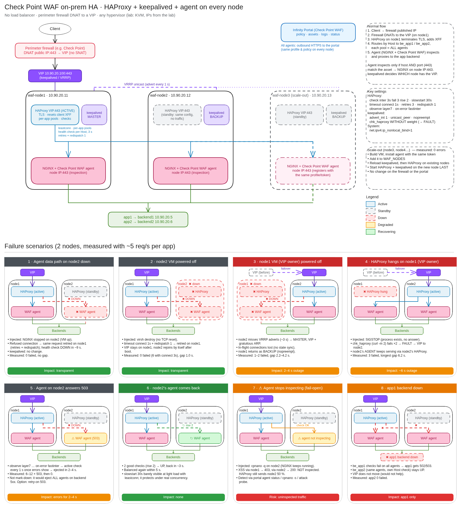

# CloudGuard WAF on-prem: HA without a load balancer

> **Disclaimer:** community lab guide. This is **not** official Check Point documentation and it is **not** supported by Check Point. Validate everything in your own environment before using it in production.

A tested, step-by-step lab for running several **Check Point CloudGuard WAF** agents on-prem in **high availability with load sharing, without a dedicated load balancer**. Typical fit: a perimeter firewall in front of the web apps, a virtualization platform, no load balancer, and the need for more than one WAF agent.

> 📘 **Start here: [GUIDE.md](GUIDE.md)**. It covers every component, the request flow, the design decisions, a step-by-step build (vSphere included), day-2 operations and the test battery, in one document.



## How it works

Every WAF node is an identical VM running three things:

| Component | Role |
|---|---|
| **keepalived** | Keeps one floating **VIP** (VRRP, unicast) on exactly one node and moves it when that node or its HAProxy fails |
| **HAProxy** | On the VIP owner: terminates TLS, adds `X-Forwarded-For`, routes by Host to a **per-app pool that contains every node's agent**, health-checks them and retries failed connections on another agent |
| **NGINX + CloudGuard WAF agent** | The Linux (NGINX add-on) deployment. Listens on the **node's own IP:443** (HAProxy owns VIP:443): the agent only inspects requests whose host **and listening port** match an asset. Inspects and proxies to the app backend |

The perimeter firewall only **DNATs the published IP to the VIP**, with no source NAT. Adding capacity means adding another identical node, with no change on the firewall or in the Infinity Portal.

## Measured results

From [chapter 9](docs/09-failover-tests.md) and [chapter 10](docs/10-scale-out.md), measured with continuous HTTPS probes (~5 req/s per app, new connection per request):

| Event | Failed requests | Longest outage |
|---|---|---|
| An agent / a non-VIP node fails (process down or VM powered off) | 0 | ≤ 1 s (a retried request) |
| The VIP owner's VM is powered off | 1–2 | **2–4 s** |
| HAProxy hangs on the VIP owner | 3 | **6.2 s** |
| An agent answers 503 | 6–12 | errors for 2–4 s until it is ejected |
| One app's backend fails | 0 **on the other app** | — |
| Planned failback, scale-out, scale-in, certificate rotation | 0 | ~0–1 s |
| **Agent stops inspecting but NGINX keeps proxying (fail-open)** | 0, but **attacks through that node are not blocked** (XSS → 200 instead of 403) and HAProxy does not notice | monitor the agent status separately |

Every node blocks attacks in Prevent mode (`EXPECT_WAF=1 bash tests/test_agent_proxy.sh`). **Read [chapter 4, section 4.2](docs/04-infinity-portal.md) first:** the agent only inspects requests whose host **and listening port** match an asset.

## Chapters

1. [Lab host](docs/01-lab-host.md): KVM/libvirt and lab networks *(lab-only)*
2. [VMs](docs/02-vms.md): Ubuntu 24.04 + cloud-init
3. [Backends](docs/03-backend.md): lab CA and two echo applications
4. [Infinity Portal](docs/04-infinity-portal.md): profile (Linux / NGINX add-on) and assets
5. [Agent](docs/05-agent.md): NGINX on node IP:443, agent install, **asset/port matching**, fail-open
6. [HAProxy](docs/06-haproxy.md): per-app pools, health checks, retries
7. [keepalived](docs/07-keepalived.md): VIP, track script, split-brain
8. [Firewall DNAT](docs/08-firewall-dnat.md): lab DNAT + Check Point NAT equivalent
9. [Failover tests](docs/09-failover-tests.md): 9 scenarios, measured
10. [Scale-out](docs/10-scale-out.md): adding and removing nodes with no downtime
11. [Certificates](docs/11-certificates.md): where they live, rotation, expiry
12. [vSphere](docs/12-vsphere.md): what changes on VMware *(not validated in the lab)*
13. [Troubleshooting](docs/13-troubleshooting.md)

## Lab quick start

Tested on Ubuntu 24.04 with KVM (12 vCPU / 31 GB; the lab uses ~10 GB of RAM with 3 WAF nodes). You need an Infinity Portal tenant to register the agents.

```bash
cp .env.example .env && tools/install-hooks.sh          # secrets stay out of git
# chapter 1: install libvirt, define the networks
# chapter 2: SSH key + cloud image, then:
# lab/inventory.env lists 3 WAF nodes (final lab state). To start with 2, remove waf-node3
# from WAF_NODES and add it later with lab/add-node.sh (chapter 10).
lab/lab-up.sh                                           # backend1/2, waf-node1/2, client
lab/certs/make-ca.sh
lab/deploy-backend.sh backend1 app1 10.90.20.5
lab/deploy-backend.sh backend2 app2 10.90.20.6
# chapter 4: create the profile + assets in the portal, put the token in .env
lab/deploy-agent.sh waf-node1 --install-agent
lab/deploy-agent.sh waf-node2 --install-agent
lab/deploy-haproxy.sh waf-node1;    lab/deploy-haproxy.sh waf-node2
lab/deploy-keepalived.sh waf-node1; lab/deploy-keepalived.sh waf-node2
lab/host-fw.sh up
bash tests/test_firewall.sh                             # end to end from the client VM
```

## Stop and start the lab

```bash
lab/lab-stop.sh     # clean shutdown of all VMs + removes the host firewall rules (nothing is deleted)
lab/lab-start.sh    # boots everything in the right order, re-applies the firewall rules,
                    # waits for the agents and runs the health checks (~2 min)
```

`lab/lab-down.sh` is different: it **deletes** all lab VMs and their disks.

## Repository layout

```
configs/      haproxy, keepalived, agent NGINX and backend templates (rendered per node)
lab/          VM factory (cloud-init), deploy scripts, host firewall, add/remove node,
              certificate scripts, scenario runner; inventory.env = names/IPs/ports
tests/        probe + summarizer (pytest), integration checks, failure scenarios, results/
tools/        vip-owner, cert expiry check, secret scanner + pre-commit hook
GUIDE.md      the complete guide (start here)
docs/         detailed chapters 01–13 with evidence, diagrams (img/), design and plan
```

`lab/inventory.env` is the single source of truth. `WAF_NODES` drives the HAProxy server lines, the keepalived peers and priorities, and every test.

## License

[MIT](LICENSE)
